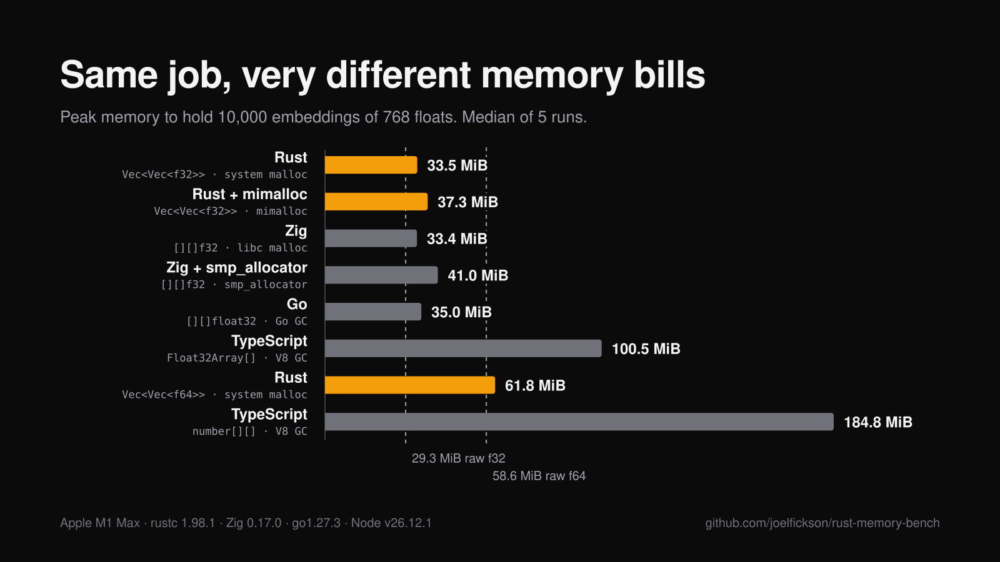
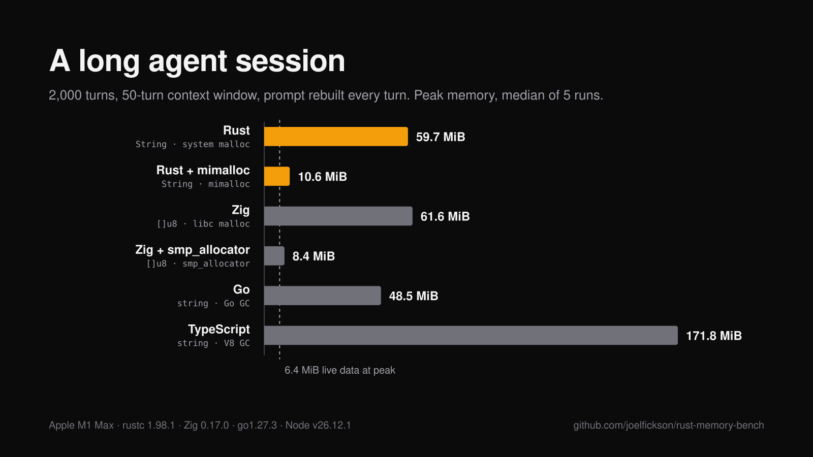
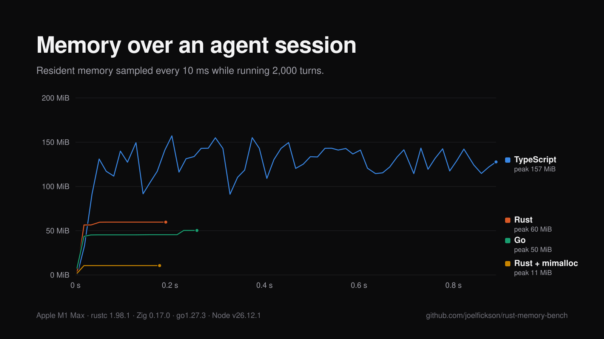

# rust-memory-bench

How much memory does the same job cost in Rust, Zig, Go and TypeScript? This repo measures it, checks that every program did the same work, and publishes the raw numbers.

It backs the post [You Can Bet On Rust](https://joelfickson.com/blog/bet-on-rust). Run it on your own machine and send a PR with your results.



## What it measures

Two workloads that show up in every AI application, written the obvious way in each language.

**Embeddings.** Hold 10,000 vectors of 768 floats in memory, then sum them. That is 29.3 MiB of raw `f32` data. This is a vector store, a batch of model outputs, or an in-memory index.

**Agent session.** Run 2,000 turns of a simulated agent. Each turn adds a 2 KiB user message and a 64 KiB tool result to the history, keeps the last 50 turns, and rebuilds the full prompt from that window. At the worst moment the program holds about 6.5 MiB of live data: the 3.2 MiB window, the 3.2 MiB prompt and the new turn. Everything else it allocates is garbage. This is the shape of a long-running agent loop.

Each language also runs an empty program, so you can see the startup cost on its own.

## Results

Apple M1 Max, macOS, 32 GiB RAM. Rust 1.98.1, Zig 0.17.0, Go 1.27.3, Node 26.12.1. Peak resident memory, median of 5 runs. Full tables, every run and wall times are in [results/darwin-arm64](results/darwin-arm64/README.md).

### Embeddings

| Program | Type | Allocator | Peak (MiB) | vs raw data |
| --- | --- | --- | ---: | ---: |
| Rust | `Vec<Vec<f32>>` | system malloc | 33.5 | 1.14x |
| Rust | `Vec<Vec<f32>>` | mimalloc | 37.3 | 1.27x |
| Zig | `[][]f32` | libc malloc | 33.4 | 1.14x |
| Zig | `[][]f32` | smp_allocator | 41.0 | 1.40x |
| Go | `[][]float32` | Go GC | 35.0 | 1.19x |
| TypeScript | `Float32Array[]` | V8 GC | 100.5 | 3.43x |
| Rust | `Vec<Vec<f64>>` | system malloc | 61.8 | 1.05x |
| TypeScript | `number[][]` | V8 GC | 184.8 | 3.15x |

JavaScript numbers are always 64-bit, so `number[][]` is compared with Rust's `Vec<Vec<f64>>` and the 58.6 MiB `f64` size, not with the `f32` rows.

### Agent session



| Program | Allocator | Peak (MiB) | vs live data | Wall time (s) |
| --- | --- | ---: | ---: | ---: |
| Rust | system malloc | 59.7 | 9.3x | 0.19 |
| Rust | mimalloc | 10.6 | 1.7x | 0.19 |
| Zig | libc malloc | 61.6 | 9.6x | 0.19 |
| Zig | smp_allocator | 8.4 | 1.3x | 0.59 |
| Go | Go GC | 48.5 | 7.5x | 0.26 |
| TypeScript | V8 GC | 171.8 | 26.8x | 0.88 |



## What the numbers say

**Static data costs about the same in Rust, Zig and Go.** When you allocate once and hold it, all three land within 2 MiB of each other. Rust has no magic here. Go's collector has nothing to collect.

**TypeScript pays for the runtime twice.** Node starts at 51.8 MiB before your code runs, and the same vectors still cost three times their raw size. Typed arrays help a lot compared with plain arrays. They do not close the gap.

**Churn is where languages split, and the allocator decides the result.** In the agent session, Rust and Zig with the default system allocator use more memory than Go: 59.7 and 61.6 MiB against 48.5. Both free every buffer the moment it is dropped. The allocation tests below prove Rust never holds more than 6.5 MiB live. The macOS allocator keeps the freed pages instead of returning them to the OS.

Change one line and that goes away. With mimalloc as Rust's global allocator, the same code peaks at 10.6 MiB. Zig gets to 8.4 MiB with its own `smp_allocator`, slower but leaner. Go and TypeScript cannot swap their allocators. The best you get is a GC tuning knob.

**Zig matches Rust on memory.** Zig gives you the same control over layout and allocation. What it does not give you is the borrow checker. In Zig a use-after-free compiles. In Rust it does not. That is the actual trade: Rust gets you this efficiency with memory safety checked at compile time.

## Proof that the work is the same

Each program prints a checksum. The harness computes the expected value on its own, without running any of the programs, and fails if any program, on any run, disagrees.

- Embeddings: every value is `(i * 768 + j) % 1024 + 0.5`. These are exactly representable in both `f32` and `f64`, so every language must produce the identical sum.
- Session: the checksum adds the prompt length and the byte in the middle of the prompt for every turn, so a program that skips building the prompt fails.

## Allocation tests

`rust/tests/allocations.rs` installs a counting global allocator and asserts exact numbers:

| Check | Asserted |
| --- | --- |
| 10,000 embeddings built | 10,001 allocations, 31,040,000 live bytes |
| Embeddings dropped | live bytes return to 0 at the end of the scope |
| 1 MB document split into owned `String` chunks | 1,955 allocations, 1,046,896 bytes |
| Same document split into borrowed `&str` chunks | 1 allocation, 31,264 bytes |
| 200-turn session | peak live bytes under two context windows, 0 live bytes after |

```sh
cargo test --release --manifest-path rust/Cargo.toml
```

## Run it

You need [mise](https://mise.jdx.dev) for Go, Node and Zig, and [rustup](https://rustup.rs) for Rust. The versions are pinned in `mise.toml` and `rust-toolchain.toml`.

```sh
mise install
node harness/bench.ts --quick
node harness/bench.ts
```

`--quick` runs once at a small size and takes a few seconds. Use it to check your setup. The full run takes under a minute and writes `results/<os>-<arch>/` with `results.json`, a markdown report and the three charts.

Flags: `--runs 5`, `--vectors 10000`, `--turns 2000`, `--out <dir>`, `--no-build`.

## How it measures

- Peak memory is the maximum resident set size from `/usr/bin/time` (`-l` on macOS, `-v` on Linux) for the benchmark process alone.
- On macOS, peak memory footprint was checked against resident set size for the session workload and agreed within 1.5 MiB.
- The timeline samples `ps -o rss` about every 10 ms, so it can miss short spikes. Use the bar charts for peaks.
- TypeScript is stripped to plain JavaScript before the run with Node's built-in `stripTypeScriptTypes`, so the numbers match what you would ship. Running `.ts` directly loads the type stripper and adds about 24 MiB.
- Builds are release builds: Rust with LTO, Zig with `ReleaseFast`, Go with default flags.

## Limits

- One machine. Allocators behave differently on Linux, where glibc returns memory differently from macOS. CI runs the quick benchmark on Linux and uploads the results.
- These are small, focused programs. A real service has more going on, and the ratios will move.
- The code is the obvious version in each language. You can make any of them leaner by reusing buffers or tuning the collector. That is part of the point: how much each language lets you control.

## Layout

```
harness/      benchmark runner and chart generation (TypeScript)
rust/         Rust workloads and allocation tests
zig/          Zig workloads
go/           Go workloads
typescript/   TypeScript workloads
results/      committed results per machine
```

## License

MIT
