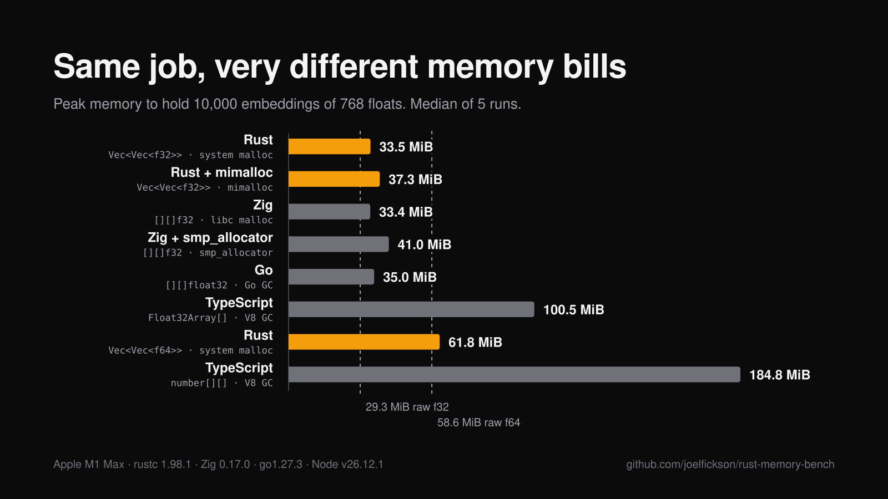
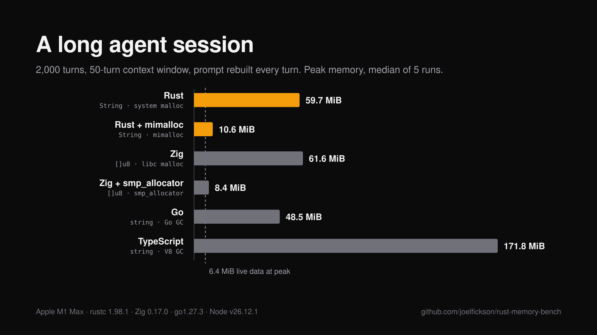
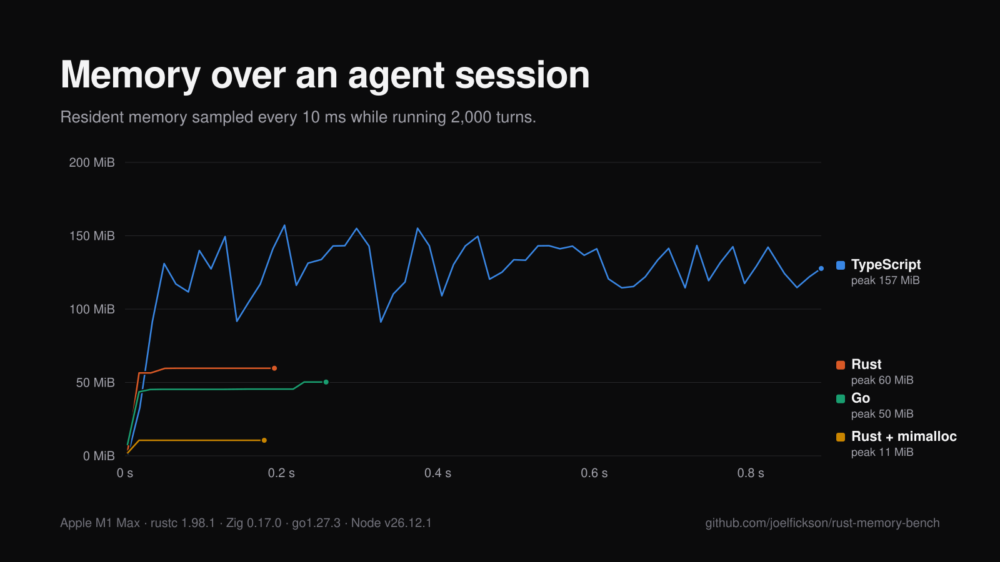

# Results: Apple M1 Max, Darwin 27.0.0

Toolchains: rustc 1.98.1 (48a229cea 2026-09-01), Zig 0.17.0, go version go1.27.3 darwin/arm64, Node v26.12.1. 32 GiB RAM. Median of 5 runs.

## Empty program

| Program | Type | Allocator | Peak memory (MiB) | Over live data | Wall time (s) | Runs (MiB) |
| --- | --- | --- | ---: | ---: | ---: | --- |
| Rust | `empty` | system malloc | 1.7 |  | 0.00 | 1.7, 1.7, 1.7, 1.7, 1.7 |
| Rust + mimalloc | `empty` | mimalloc | 2.2 |  | 0.00 | 2.2, 2.2, 2.2, 2.2, 2.2 |
| Zig | `empty` | libc malloc | 1.9 |  | 0.00 | 1.9, 1.9, 1.9, 1.9, 1.9 |
| Zig + smp_allocator | `empty` | smp_allocator | 1.9 |  | 0.00 | 1.9, 1.9, 1.9, 1.9, 1.9 |
| Go | `empty` | Go GC | 4.3 |  | 0.00 | 4.2, 4.4, 4.2, 4.3, 4.3 |
| TypeScript | `empty` | V8 GC | 51.8 |  | 0.03 | 52.0, 51.8, 51.9, 51.8, 51.8 |

## Embeddings: 10,000 x 768

Raw data is 29.3 MiB as f32 and 58.6 MiB as f64. JavaScript numbers are always 64-bit, so `number[][]` is compared against the f64 size.

| Program | Type | Allocator | Peak memory (MiB) | Over live data | Wall time (s) | Runs (MiB) |
| --- | --- | --- | ---: | ---: | ---: | --- |
| Rust | `Vec<Vec<f32>>` | system malloc | 33.5 | 1.14x | 0.01 | 33.5, 33.5, 33.5, 33.5, 33.5 |
| Rust + mimalloc | `Vec<Vec<f32>>` | mimalloc | 37.3 | 1.27x | 0.01 | 37.3, 37.3, 37.3, 37.3, 37.3 |
| Zig | `[][]f32` | libc malloc | 33.4 | 1.14x | 0.01 | 33.4, 33.4, 33.4, 33.4, 33.4 |
| Zig + smp_allocator | `[][]f32` | smp_allocator | 41.0 | 1.40x | 0.02 | 41.0, 41.0, 41.0, 41.0, 41.0 |
| Go | `[][]float32` | Go GC | 35.0 | 1.19x | 0.02 | 35.1, 34.8, 35.1, 35.0, 34.8 |
| TypeScript | `Float32Array[]` | V8 GC | 100.5 | 3.43x | 0.09 | 100.5, 100.3, 100.1, 100.8, 100.9 |
| Rust | `Vec<Vec<f64>>` | system malloc | 61.8 | 1.05x | 0.01 | 61.8, 61.8, 61.8, 61.8, 61.8 |
| TypeScript | `number[][]` | V8 GC | 184.8 | 3.15x | 0.08 | 184.8, 184.8, 184.7, 185.1, 184.3 |

Startup cost removed (peak minus the empty program for the same language):

| Program | Type | Peak minus empty (MiB) |
| --- | --- | ---: |
| Rust | `Vec<Vec<f32>>` | 31.8 |
| Rust + mimalloc | `Vec<Vec<f32>>` | 35.1 |
| Zig | `[][]f32` | 31.5 |
| Zig + smp_allocator | `[][]f32` | 39.1 |
| Go | `[][]float32` | 30.7 |
| TypeScript | `Float32Array[]` | 48.7 |
| Rust | `Vec<Vec<f64>>` | 60.1 |
| TypeScript | `number[][]` | 133.0 |

## Agent session: 2,000 turns

The live data at the worst moment is about 6.4 MiB: the 50-turn window (3.2 MiB) plus the prompt built from it (3.2 MiB).

| Program | Type | Allocator | Peak memory (MiB) | Over live data | Wall time (s) | Runs (MiB) |
| --- | --- | --- | ---: | ---: | ---: | --- |
| Rust | `String` | system malloc | 59.7 | 9.33x | 0.19 | 59.7, 59.7, 59.7, 59.0, 59.7 |
| Rust + mimalloc | `String` | mimalloc | 10.6 | 1.66x | 0.19 | 10.6, 10.6, 10.6, 10.6, 10.6 |
| Zig | `[]u8` | libc malloc | 61.6 | 9.63x | 0.19 | 61.6, 62.4, 58.4, 61.6, 58.6 |
| Zig + smp_allocator | `[]u8` | smp_allocator | 8.4 | 1.31x | 0.59 | 8.4, 8.4, 8.4, 8.4, 8.4 |
| Go | `string` | Go GC | 48.5 | 7.58x | 0.26 | 48.5, 48.5, 45.5, 45.4, 54.9 |
| TypeScript | `string` | V8 GC | 171.8 | 26.84x | 0.88 | 173.3, 171.9, 171.8, 171.6, 171.8 |

