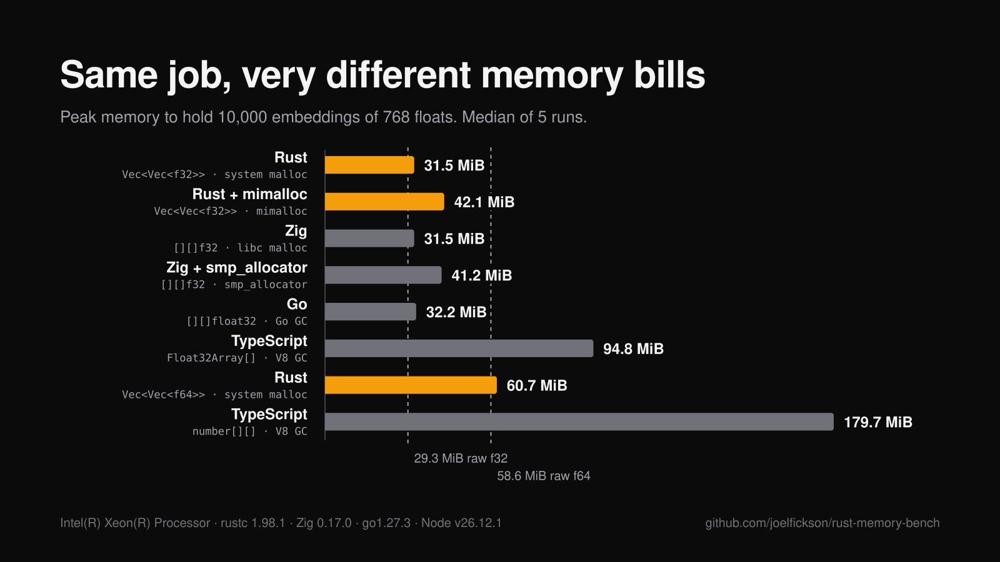
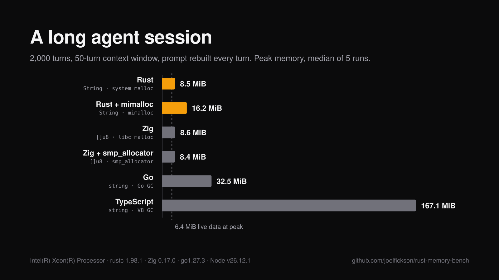
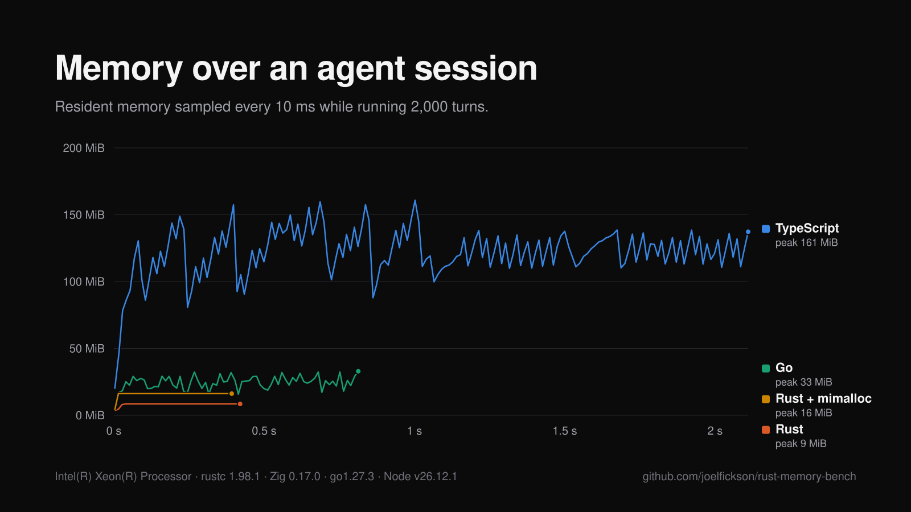

# Results: Intel(R) Xeon(R) Processor, Linux 6.12.113+

Toolchains: rustc 1.98.1 (48a229cea 2026-09-01), Zig 0.17.0, go version go1.27.3 linux/amd64, Node v26.12.1. 16 GiB RAM. Median of 5 runs.

## Empty program

| Program | Type | Allocator | Peak memory (MiB) | Over live data | Wall time (s) | Runs (MiB) |
| --- | --- | --- | ---: | ---: | ---: | --- |
| Rust | `empty` | system malloc | 1.8 |  | 0.00 | 1.9, 1.8, 1.8, 1.8, 2.0 |
| Rust + mimalloc | `empty` | mimalloc | 6.1 |  | 0.00 | 6.1, 6.1, 6.1, 6.1, 6.1 |
| Zig | `empty` | libc malloc | 2.0 |  | 0.00 | 2.0, 2.0, 2.0, 2.0, 2.0 |
| Zig + smp_allocator | `empty` | smp_allocator | 2.0 |  | 0.00 | 2.0, 2.0, 2.0, 2.0, 2.0 |
| Go | `empty` | Go GC | 1.8 |  | 0.00 | 1.8, 1.8, 1.8, 1.8, 1.8 |
| TypeScript | `empty` | V8 GC | 46.9 |  | 0.02 | 46.9, 46.9, 46.9, 47.0, 46.9 |

## Embeddings: 10,000 x 768

Raw data is 29.3 MiB as f32 and 58.6 MiB as f64. JavaScript numbers are always 64-bit, so `number[][]` is compared against the f64 size.

| Program | Type | Allocator | Peak memory (MiB) | Over live data | Wall time (s) | Runs (MiB) |
| --- | --- | --- | ---: | ---: | ---: | --- |
| Rust | `Vec<Vec<f32>>` | system malloc | 31.5 | 1.08x | 0.01 | 31.5, 31.5, 31.5, 31.7, 31.7 |
| Rust + mimalloc | `Vec<Vec<f32>>` | mimalloc | 42.1 | 1.44x | 0.01 | 42.1, 42.1, 42.1, 42.1, 42.1 |
| Zig | `[][]f32` | libc malloc | 31.5 | 1.08x | 0.01 | 31.5, 31.5, 31.5, 31.5, 31.5 |
| Zig + smp_allocator | `[][]f32` | smp_allocator | 41.2 | 1.41x | 0.02 | 41.2, 41.2, 41.2, 41.2, 41.2 |
| Go | `[][]float32` | Go GC | 32.2 | 1.10x | 0.02 | 32.2, 32.2, 32.1, 32.1, 32.2 |
| TypeScript | `Float32Array[]` | V8 GC | 94.8 | 3.24x | 0.08 | 94.8, 94.6, 94.7, 94.9, 95.0 |
| Rust | `Vec<Vec<f64>>` | system malloc | 60.7 | 1.04x | 0.02 | 60.6, 60.8, 60.8, 60.6, 60.7 |
| TypeScript | `number[][]` | V8 GC | 179.7 | 3.07x | 0.08 | 179.7, 179.4, 179.6, 179.7, 179.7 |

Startup cost removed (peak minus the empty program for the same language):

| Program | Type | Peak minus empty (MiB) |
| --- | --- | ---: |
| Rust | `Vec<Vec<f32>>` | 29.7 |
| Rust + mimalloc | `Vec<Vec<f32>>` | 36.0 |
| Zig | `[][]f32` | 29.5 |
| Zig + smp_allocator | `[][]f32` | 39.2 |
| Go | `[][]float32` | 30.4 |
| TypeScript | `Float32Array[]` | 47.9 |
| Rust | `Vec<Vec<f64>>` | 58.9 |
| TypeScript | `number[][]` | 132.8 |

## Agent session: 2,000 turns

The live data at the worst moment is about 6.4 MiB: the 50-turn window (3.2 MiB) plus the prompt built from it (3.2 MiB).

| Program | Type | Allocator | Peak memory (MiB) | Over live data | Wall time (s) | Runs (MiB) |
| --- | --- | --- | ---: | ---: | ---: | --- |
| Rust | `String` | system malloc | 8.5 | 1.33x | 0.42 | 8.5, 8.6, 8.5, 8.6, 8.5 |
| Rust + mimalloc | `String` | mimalloc | 16.2 | 2.53x | 0.40 | 16.1, 16.2, 16.2, 16.2, 16.1 |
| Zig | `[]u8` | libc malloc | 8.6 | 1.34x | 0.41 | 8.6, 8.6, 8.6, 8.6, 8.6 |
| Zig + smp_allocator | `[]u8` | smp_allocator | 8.4 | 1.31x | 1.70 | 8.4, 8.4, 8.4, 8.4, 8.4 |
| Go | `string` | Go GC | 32.5 | 5.08x | 0.81 | 35.9, 35.8, 32.5, 32.5, 32.4 |
| TypeScript | `string` | V8 GC | 167.1 | 26.11x | 2.06 | 167.2, 167.0, 167.1, 166.9, 167.1 |

